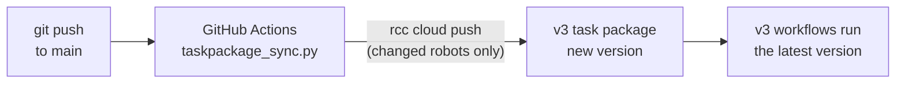

# Publish robots from Git to v3

Push to `main`, and every robot that changed gets a new version in its v3 task package.



## Quick start (GitHub)

1. **Get two ids from v3.** Open the task package → **Publish → Publish with rcc**. The command there shows the package id (`-r`) and the account id (`-w`).
2. **Create a credential.** Account menu → **Access credentials**. Copy the `identifier:secret` value.
3. **Add three files** to your repository:

   | Copy this | To |
   |---|---|
   | [`github/publish-to-v3.yml`](github/publish-to-v3.yml) | `.github/workflows/publish-to-v3.yml` |
   | [`taskpackage_sync.py`](taskpackage_sync.py) | `v3-publish/taskpackage_sync.py` |
   | [`v3-packages.yaml`](v3-packages.yaml) | `v3-publish/v3-packages.yaml`, with your ids filled in |

   ```yaml
   environments:
     default:
       workspace: <account id>
   packages:
     robots/invoice-bot:        # the folder holding robot.yaml
       default: <package id>
   ```

4. **Add the credential and your v3 address to GitHub.** Under **Settings → Secrets and variables → Actions**, add the secret `V3_RCC_CREDENTIALS` and the variable `V3_URL`, for example `https://us3.sema4.ai`.
5. **Push.** The **Publish to v3** run lists each robot it published.

## Next

* **[DEV and PROD](dev-prod.md):** pull request checks, merges to DEV, and releases to PROD after approval.
* **[GitLab CI](gitlab.md)** (DRAFT): the same two setups on GitLab.
* **[Reference](reference.md):** mapping file, script options and current limits. For example, the credential publishes as you, for now.
