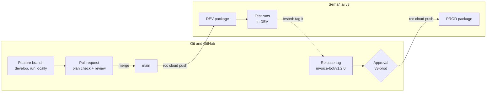
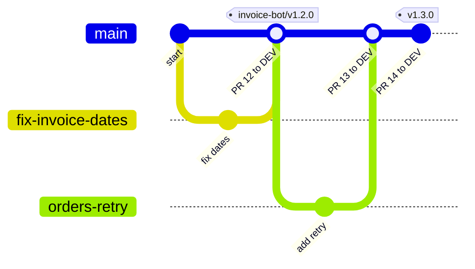
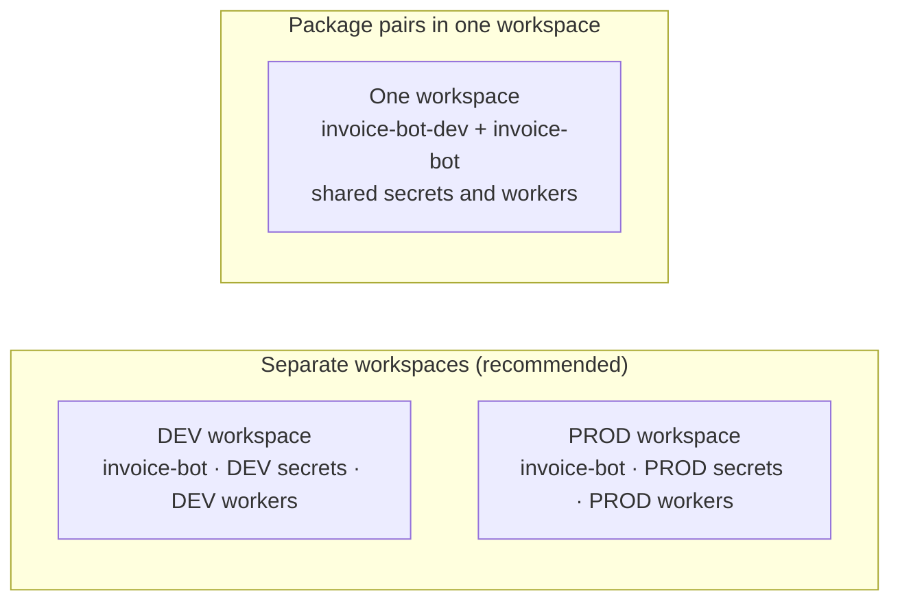
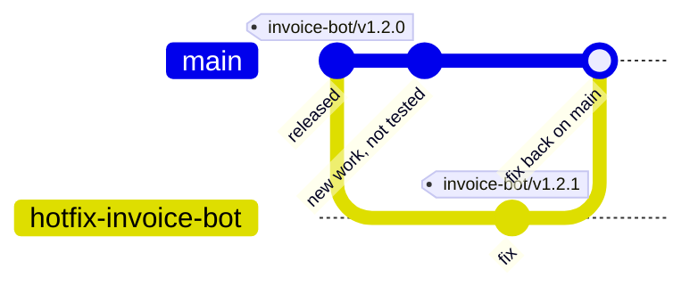

# DEV and PROD

The [quick start](README.md) publishes every merge straight into the package your workflows run. For production robots, add the usual development lifecycle around it:
* every change is reviewed;
* every merge goes to DEV first;
* PROD gets only releases that someone approved.

Start from a working quick start; this page builds on it.

## The lifecycle



| Stage | What happens | Gate |
|---|---|---|
| **Develop** | Work on a short-lived branch, and run the robot locally with rcc or VS Code. | None |
| **Review** | Open a pull request. The `plan` check lists the DEV packages the merge will publish, and fails if the mapping is broken. | Required review and a passing `plan` check, on a protected `main` |
| **Integrate** | Merging publishes each changed robot to its DEV package. | Only through a reviewed pull request |
| **Test** | Run the robot's DEV workflow in v3 and check the results. | Your test sign-off |
| **Release** | Tag the tested commit: `invoice-bot/v1.2.0` releases one robot, `v1.2.0` releases them all. The job waits for an approver, then publishes to PROD. | Protected tags, and required reviewers on `v3-prod` |
| **Operate** | v3 workflows run the newest PROD version. Roll back or hotfix as described [below](#rollback). | Same as Release |

## In Git

All work lands on `main`, and releases are tags on `main`. There are no long-lived environment branches.



* **PROD runs exactly what DEV tested.** A tag points at a commit that is already on `main`, so the bundle that reaches PROD is the one DEV ran, byte for byte.
* **"What's in PROD?" is answered by the latest release tag.** v3 doesn't record the commit yet, so the tag and the CI run are the record.
* **Robots release independently.** One repository can hold many robots, and a tag with a robot's name releases only that one.
* **Avoid a `dev` branch beside `main`.** Promoting between branches makes them drift apart through hotfixes and two-way merges, and PROD ends up running a merge result that never ran in DEV.

## DEV and PROD in v3



* **Separate workspaces** keep DEV runs away from production secrets, assets and workers. Package, secret and asset names can be identical in both, because a robot reads whichever workspace it runs in. This matches how most Control Room customers split their environments.
* **Package pairs** are fine for small teams and trials.

The mapping file is the same for both; only the ids differ.

## Setup

### 1. Create the DEV packages and workflows

For each robot, create a DEV package, either in your DEV workspace or next to the PROD one with a `-dev` name. Then create a v3 workflow that runs it, so you have something to test with. Your existing packages become PROD.

### 2. Protect `main` and the release tags

Under **Settings → Rules → Rulesets**:

* **Branch ruleset for `main`:** require a pull request with at least one approval, and require the status check `plan`.
* **Tag ruleset for `*/v*` and `v*`:** restrict creation, update and deletion, with release managers in the bypass list.

### 3. Create the environments

Under **Settings → Environments**:

| Environment | Settings | Secret `V3_RCC_CREDENTIALS` |
|---|---|---|
| `v3-dev` | None | A credential that can publish to the DEV packages |
| `v3-prod` | **Required reviewers:** your release approvers. **Deployment branches and tags:** tags `*/v*` and `v*` only. | A credential that can publish to the PROD packages |

Then delete the repository secret from the quick start. An environment secret reaches only jobs that pass that environment's rules, while a repository secret reaches every run from any branch. Keep `V3_URL` as a repository variable.

In a private repository, environments need GitHub Pro, Team or Enterprise, and required reviewers need Enterprise Cloud.

### 4. Switch the mapping and the workflow

Rename `default` to `dev` in `v3-publish/v3-packages.yaml`, and add `prod`. See [`v3-packages-dev-prod.yaml`](v3-packages-dev-prod.yaml):

```yaml
environments:
  dev:
    workspace: <dev account id>
  prod:
    workspace: <prod account id>   # same as dev for package pairs
packages:
  robots/invoice-bot:
    dev: <dev package id>
    prod: <prod package id>
```

Replace `.github/workflows/publish-to-v3.yml` with [`github/publish-to-v3-dev-prod.yml`](github/publish-to-v3-dev-prod.yml), keeping the file name. Push. A changed mapping publishes every robot to DEV once.

## Day to day

### Release

```bash
git tag invoice-bot/v1.2.0 <tested commit>
git push origin invoice-bot/v1.2.0
```

Under **Actions**, the run shows **Review deployments**. An approver ticks `v3-prod` and approves, and the robot's PROD package gets a new version.

### Rollback

Open the run of the previous release tag and choose **Re-run all jobs**. After approval, that version is published again as the newest one.

### Hotfix

When `main` already holds untested work for the same robot, fix from the released tag instead:



1. Branch from the tag: `git switch -c hotfix-invoice-bot invoice-bot/v1.2.0`.
2. Commit the fix and push the branch.
3. Under **Actions → Publish to v3 → Run workflow**, choose the hotfix branch. This publishes every robot from that branch to DEV, where you test the fix. Afterwards, run the workflow on `main` to put DEV back on `main`.
4. Tag the fix `invoice-bot/v1.2.1`, and release it as usual.
5. Merge the hotfix branch back to `main` through a pull request.

When `main` holds nothing untested for that robot, skip the branch: fix on `main` and release from there.
